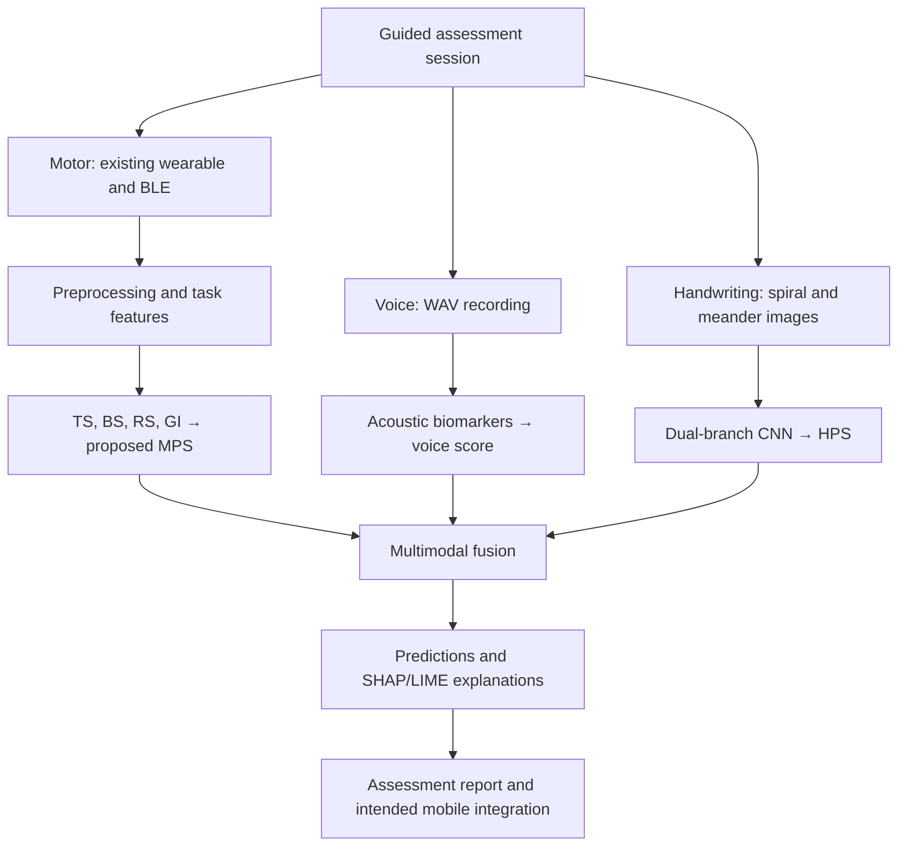

[README-J26-IT-401 .md](https://github.com/user-attachments/files/34195358/README-J26-IT-401.md)
# Explainable Multimodal AI Framework for Parkinsonian Disorder Screening

**Portable motor sensing, voice biomarkers, paired handwriting images and explainable multimodal fusion for screening research.**

**Project ID:** J26-IT-401  
**Module:** Research Project – IT4010  
**Institution:** Sri Lanka Institute of Information Technology (SLIIT)  
**Documentation updated:** 30 October 2026

> Research prototype. Component experiments and a synthetic fusion demonstration are available, but the complete system has not been clinically validated. Reported results below refer to different datasets and evaluation protocols; they are not an end-to-end system accuracy.

## Project Overview

**Official title:** Development of an Explainable Multimodal Artificial Intelligence Framework for Early Screening of Parkinsonian Disorders Using a Portable Electronic Sensing Device and Mobile Application.

The framework investigates complementary evidence from movement, voice and handwriting. Three assessment components produce modality-specific outputs, and a fourth component studies how to combine them and explain the resulting predictions. A mobile application is intended to guide assessments and support review.

The research targets experimental screening profiles for Parkinson’s disease (PD), essential tremor (ET), cerebellar ataxia (CA), atypical parkinsonism (AP) and dementia with Lewy bodies (DLB). Current motor, voice and handwriting datasets do not collectively establish a real-patient five-condition benchmark. The current five-class fusion experiment uses simulated cases and has no healthy class.

## Research Team

| Component | Student | IT number |
| --- | --- | --- |
| Motor Assessment | H. N. Dissanayaka | IT23378384 |
| Voice Assessment | P. B. G. P. N. Wickramasinhe | IT23311404 |
| Handwriting Assessment | N. A. K. Tharuka | IT23447370 |
| Explainable Multimodal Fusion | K. M. D. S. Sapnachapa | IT23390614 |

**Main supervisor:** Dr. Kapila Dissanayaka  
**Co-supervisor:** Mr. Chamindu Rathsara

## System Architecture

This diagram describes the intended integration. The PP1 fusion prototype currently receives three supplied scores; live connections to the three assessment components and the shared Android application remain pending.

## Current Development Status

| Area | Available evidence | Remaining work |
| --- | --- | --- |
| Motor | Public-data audit, feature extraction, grouped baseline experiments, output schemas and BLE discovery/GATT inspection | Live BLE receiving, clinically referenced task scoring and validated MPS |
| Voice | Feature extraction, duplicate audit, recorded RF/SVM baselines | Reproduce final deduplicated splits, verify speaker independence and XGBoost, evaluate biomarker fusion |
| Handwriting | Custom dual-branch CNN, grouped evaluation, Platt score mapping and basic Grad-CAM | Independent calibration checks, quality gate, confidence estimation and fusion integration |
| Fusion | Reproducible synthetic benchmark, RF/logistic baselines, SHAP/LIME and browser reporting prototype | Aligned real data, learned reliability gate, calibrated outputs and missing-modality inference |
| Mobile application | Intended assessment and integration workflow | Complete and verify Android/backend integration |

## Component 1 — Motor Assessment

### Scope and Device

The portable sensing device is already built by the supervisor. The Motor Assessment responsibility covers obtaining its sensor data through BLE, preprocessing, feature extraction, model development and integration. Hardware assembly and firmware development are outside this component’s current scope unless an interface change is agreed with the supervisor.

The device uses an ESP32-class controller, an MPU-6050 three-axis accelerometer and gyroscope, and a capacitive touch sensor. The intended IMU rate is approximately 100 Hz; processing must use the recording timestamps to check the actual rate.

| Task | Input | Protocol duration | Candidate measurements | Intended score |
| --- | --- | --- | --- | --- |
| Tremor | Accelerometer | 10 s | Dynamic acceleration RMS, jerk RMS, peak amplitude | TS, 0–4 |
| Bradykinesia | Capacitive touch events | 10 s | Tap cadence, inter-tap variability, pauses and slowing | BS, 0–4 |
| Rigidity-related movement | Gyroscope | 10 s | Cycle peaks and mean peak angular velocity | RS, 0–4 |
| Gait | Accelerometer | 180 s | Step count, cadence, acceleration RMS and interruptions | GI, 0–4 |

The proposed aggregation is a learned motor model:

\[
\mathbf{x}_M=[TS,BS,RS,GI],\qquad MPS=f_M(\mathbf{x}_M),\quad MPS\in[0,1].
\]

The interpretation of MPS must be agreed before fusion. A normalized motor severity score is not automatically a probability of PD. Task-level 0–4 outputs and MPS remain unavailable until their reference labels and calibration are established; the prepared interface represents unavailable values as `null`.

Gyroscope motion is a mobility proxy and does not directly establish clinical passive rigidity. RS requires an appropriate reference protocol and clinician validation.

### Public-Data Development

Previously audited PADS work covered 36 participants, with 12 healthy, 12 PD and 12 heterogeneous “Other” participants. The manifest contained 144 recording entries; 142 recordings were completed and two zero-byte partial files were excluded. Feature extraction produced 28 features per recording. A subsequent timestamp quality gate left 104 eligible recordings.

The corrected format contains a timestamp plus six sensor channels. Sampling frequency is derived per recording. The older starter README’s six-column-only description and unconditional removal of the first 50 samples have been superseded by the later audit.

RF, SVM and XGBoost were compared using participant-grouped development splits. The binary held-out test contained only four participants: two PD and two healthy. Reported participant-level balanced accuracy was RF 0.50, SVM 0.75 and XGBoost 1.00; all had ROC-AUC 1.00 on that very small test. SVM was selected by grouped cross-validation. These are diagnosis-label feasibility results, not TS/BS/RS/GI severity results.

BLE discovery and read-only GATT inspection were prepared. Device service UUIDs, characteristics, payload structure, timestamps, units and notification behaviour still need confirmation before live acquisition. Previously reported automated checks are historical project evidence and were not rerun for this documentation update.

## Component 2 — Voice Assessment

**Individual research:** Multi-Level Voice Biomarker Fusion Framework for Explainable Parkinson’s Disease Assessment.

The voice component investigates three complementary feature groups:

| Group | Examples |
| --- | --- |
| Voice quality | Jitter, shimmer and harmonics-to-noise ratio |
| Spectral | MFCCs and spectral statistics |
| Prosodic | Pitch statistics, F0 variation and speech timing where available |

The working collection initially contained 1,134 WAV files. Hash auditing found 567 exact duplicate pairs, leaving **567 unique audio files: 287 healthy-labelled and 280 Parkinson-labelled**. Unique audio files do not establish unique speakers. The initial feature export had 1,134 rows and 26 columns and requires a deduplicated export and schema verification.

The reported workflow uses audio validation, Librosa feature extraction, missing-value checks, and training-only transformations. The candidate models are Random Forest, SVM and XGBoost. Feature-group fusion and SHAP/LIME are research extensions awaiting verified experiments.

| Model | Recorded accuracy | Recorded F1 | Evidence status |
| --- | --- | --- | --- |
| Random Forest | 95.61% | 0.9565 | Split, duplicate removal and speaker independence require verification |
| SVM | 93.86% | 0.9369 | Same evaluation limitations |
| XGBoost | Not verified | Not verified | Final notebook required |

The recorded confusion matrices are RF `[[54, 4], [1, 55]]` and SVM `[[55, 3], [4, 52]]`, each with 114 predictions. These development results cannot establish performance on unseen patients until the partitioning audit is complete. Independent Sinhala speech and recording-device robustness have not been established.

## Component 3 — Handwriting Assessment

The component processes a **spiral and meander image pair** from the same participant and repetition. It produces a Handwriting PD Score (HPS) in `[0,1]`. Static images provide visual patterns; pen velocity, acceleration and pressure are not measured.

### Dataset and Model

The final PP1 model uses **NewHandPD: 66 participants, 264 image pairs and 528 images**. There are 35 healthy and 31 PD participants, each contributing four pairs. The development set contains 56 participants and 224 pairs; the held-out set contains 10 participants and 40 pairs.

The model is a custom dual-branch CNN trained from scratch with no pretrained weights. Each branch receives a grayscale `192 × 192` image, learns a 32-value representation, and joins the representations before the sigmoid output. The model has 125,729 parameters. Training uses five-fold participant-grouped cross-validation, fixed 40 epochs, batch size 8, Adam with learning rate `3e-4`, and training-only augmentation.

HPS is derived using Platt scaling fitted to development out-of-fold predictions. The raw decision threshold is 0.9341, corresponding to an HPS threshold of 0.4639. The score mapping and threshold still need independent validation; HPS is not established as clinical risk.

### Reported Results

| Evaluation | Unit | Accuracy | Balanced accuracy | ROC-AUC |
| --- | --- | --- | --- | --- |
| Development OOF | 56 participants | 87.5% | 87.8% | 0.895 |
| Held-out ensemble | 10 participants | 80.0% | 83.3% | 0.708 |
| Held-out ensemble | 40 image pairs | 80.0% | 83.3% | 0.755 |

The participant test correctly classified eight of ten participants, finding all four PD cases and flagging two of six healthy participants. The sample is small, and the same held-out participants appeared in earlier experiments. Further tuning requires a new reserved test set.

Basic Grad-CAM is implemented for both branches. Automated blur/lighting/alignment checks, a confidence estimate, plain-language explanations and score transfer to Component 4 remain planned. Earlier HandPD experiments and pretrained comparisons used a different cohort and do not provide a direct model ranking against the final NewHandPD model.

## Component 4 — Explainable Multimodal Fusion

**Individual research:** Quality-, Uncertainty-, Disagreement- and Availability-Aware Explainable Multimodal Fusion for Robust Parkinsonian Screening.

The PP1 prototype accepts three numeric, finite scores in `[0,1]`, always ordered as:

1. `motor_pd_probability`
2. `voice_pd_probability`
3. `handwriting_pd_probability`

These fields currently contain simulated upstream PD scores. Labels, IDs and generator metadata are excluded from the predictor inputs. The system rejects malformed inputs and returns an incomplete result without prediction when a required score is missing.

### Synthetic Benchmark

The active dataset contains **1,000 simulated cases**, with 200 assigned labels per condition: PD, ET, CA, AP and DLB. Each condition contributes 120 training, 40 validation and 40 test cases, giving a 600/200/200 split.

The scores are generated from assumed profiles with correlated noise. They are not measured patient outputs, and the dataset was not formed by joining different patients from the three upstream datasets.

The serving baseline is a 240-tree Random Forest with minimum leaf size 6, `max_features=1.0`, balanced class weights and seed 1401. Candidate selection uses validation macro F1, with cross-validation confined to training. A saved score-preprocessing/classifier pipeline supports the browser assessment and printable report demonstration.

| Model | Synthetic test accuracy | Macro F1 |
| --- | --- | --- |
| Random Forest fusion | 85.5% | 0.853 |
| Logistic regression fusion | 86.5% | 0.864 |
| Motor score only | 48.5% | 0.479 |
| Voice score only | 42.5% | 0.427 |
| Handwriting score only | 39.5% | 0.390 |

Random Forest classified 171 of 200 synthetic test cases correctly. Logistic regression performed slightly better in this experiment; RF is retained as the PP1 tree-based baseline, not established as the best final model.

| RF robustness condition | Cases | Accuracy | Macro F1 |
| --- | --- | --- | --- |
| Separate sample, same moderate generator | 500 | 83.8% | 0.837 |
| Added score noise, SD 0.10 | 200 | 75.0% | 0.750 |
| Harder-overlap test | 200 | 62.5% | 0.619 |
| Wider-overlap imbalanced stress sample | 500 | 52.0% | 0.493 |

TreeSHAP and LIME explain the baseline’s score contributions. A learned reliability gate, measured quality/uncertainty inputs, post-hoc calibration and prediction with missing modalities are not yet implemented. Current disagreement and ambiguity flags are prototype rules.

Planned real-data experiments use aligned multimodal participants from UFNet/PARK, with an exploratory voice/drawing pilot from UT-MoDaPark. Facial-expression inputs in the UFNet/PARK development plan are proxy inputs and must not be described as handwriting. Five-condition validation requires a separately suitable labelled cohort.

## Integration Contract and Score Meaning

The intended upstream notation is **MPS, VPS and HPS**, each in `[0,1]`. A common range does not guarantee a common meaning or calibration.

| Output | Intended meaning | Integration requirement |
| --- | --- | --- |
| TS / BS / RS / GI | Task-level motor severity indicators, 0–4 | Clinically referenced task labels and validation |
| MPS | Proposed Motor Parkinsonism Score, 0–1 | Establish whether it measures severity, resemblance or PD probability |
| VPS | Voice-derived PD screening score, 0–1 | Verify positive class, speaker-independent evaluation and calibration |
| HPS | Calibrated handwriting PD-pattern score, 0–1 | Validate calibration and image-quality behaviour independently |
| Fusion output | Experimental five-class distribution | Retrain and evaluate on compatible aligned outputs; current model is synthetic-trained |

The current fusion API expects PD probability inputs. MPS must not be copied into `motor_pd_probability` merely because its range is `[0,1]`. The team must first agree score semantics and validate any mapping. The same requirement applies to voice and handwriting scores.

Integration should carry participant ID, session ID, modality availability, model/schema versions and genuinely measured quality fields. Unavailable values must remain unavailable rather than being replaced with invented scores. A shared participant/session identity must refer to the same person and assessment context across modalities.

## Technology Stack

| Layer | Reported or intended technologies | Status |
| --- | --- | --- |
| Existing wearable | ESP32-class MCU, MPU-6050, capacitive touch sensor | Supervisor-provided device |
| Motor processing | Python, NumPy, SciPy, scikit-learn, XGBoost | Feature/baseline development reported |
| BLE tools | Python, Bleak | Discovery/GATT inspection prepared; stream integration pending |
| Voice | Python, Librosa, scikit-learn, XGBoost | Extraction and partial baseline evidence |
| Handwriting | Keras custom dual-branch CNN, `.keras` fold models | PP1 implementation reported |
| Fusion | scikit-learn, joblib, SHAP, LIME | Synthetic PP1 prototype reported |
| Interface | Browser demonstration; intended shared Android app | Android integration pending |
| Version control | Git / GitHub | Repository-specific configuration to verify |

## Repository Organization

The following is a **suggested organization**, not a verified listing of the current repository. Preserve the actual existing paths when applying this README.

| Suggested directory | Contents |
| --- | --- |
| `motor-assessment/` | BLE tools, sensor preprocessing, task features and motor experiments |
| `voice-assessment/` | Audio audit, feature extraction and voice experiments |
| `handwriting-assessment/` | Image pairing, CNN training, calibration and Grad-CAM |
| `fusion-explainability/` | Score preprocessing, synthetic generator, baselines and explanations |
| `mobile-app/` | Shared assessment application and integration |
| `shared/` | Agreed schemas, score definitions and versioned interfaces |
| `docs/` | Protocols, component reports and evaluation records |
| `tests/` | Relevant data-integrity, interface and processing checks |

## Development and Reproducibility

This README update is based on reports and earlier project records. The current repository source, dependency manifests and entry points were not supplied, so repository-specific installation or launch commands cannot be verified here.

To reproduce an experiment from the actual repository:

1. Use its recorded dependency file and environment; avoid treating the combined technology table as a single installation manifest.
2. Obtain each dataset from its authorised source and retain its licence and provenance.
3. Validate files, labels, participant identities, timestamps or image pairing, and exact duplicates before partitioning.
4. Freeze participant-grouped development and test partitions wherever participant IDs exist. Record limitations when voice speaker IDs are unavailable.
5. Fit transformations, augmentation, model selection and calibration using the permitted development partitions only.
6. Record seeds, configurations, model versions, split manifests, metrics and class order alongside saved models.
7. Verify score definitions and interface compatibility before testing component integration.

Synthetic training targets must be marked as assumption-based. Public diagnosis labels must not be relabelled as clinical 0–4 motor severity. Augmented variants belong only to training participants, and unrelated cohorts must not be presented as matched multimodal patients.

## Evaluation and Limitations

- **Motor labels:** Public diagnosis classification does not establish four calibrated motor-severity models.
- **Voice leakage:** The initial audio inventory contained exact duplicates; final split and speaker independence remain to be verified.
- **Handwriting sample size:** The held-out result covers only ten participants, and phone-captured drawings remain untested.
- **Fusion simulation:** Accuracy measures agreement with assigned simulator labels and is sensitive to assumed class profiles and noise.
- **Unmatched cohorts:** Current upstream datasets contain different participants. Combining their rows cannot create real aligned patient records.
- **Probability semantics:** Severity scores, PD-pattern scores and calibrated clinical probabilities are different quantities.
- **Clinical scope:** Current fusion has no healthy class and must not force a real person into one of five diagnoses.
- **Integration:** No verified end-to-end clinical result or completed Android integration is claimed.

SHAP, LIME and Grad-CAM describe model behaviour. Their outputs do not establish clinical mechanisms or validate a prediction.

## Next Milestones

- Complete the BLE stream contract and test acquisition from the existing motor device.
- Establish independently referenced TS/BS/RS/GI targets and the definition of MPS.
- Reproduce voice baselines after deduplication and resolve speaker-grouping limitations.
- Add and evaluate handwriting quality checks, confidence estimates and independent calibration.
- Agree shared score semantics and participant/session identifiers.
- Generate leakage-aware aligned real-data predictions for fusion development.
- Evaluate the proposed reliability gate, calibration and missing-modality handling against the baselines.
- Connect component inference and reports to the shared application.
- Perform independently approved clinician-labelled evaluation and report uncertainty.

## Documentation Sources

This update draws on the supplied component reports and earlier motor project records:

1. Voice Assessment Data Analysis Report — IT23311404, updated report supplied for this README.
2. Component 3 Handwriting Assessment Data Analysis Report — IT23447370, NewHandPD dual-branch CNN prototype.
3. Component 4 Data Analysis Report — IT23390614, synthetic PP1 fusion implementation and evaluation.
4. Earlier Motor Assessment audit, feature-extraction, model-comparison and BLE inspection records — IT23378384.
5. Earlier project `README.md` and `Motor_AI_README.md`, used for documentation structure; superseded descriptions have been updated using later evidence.

The uploaded `Motor Assesment - Shortcut(1).lnk` is a shortcut to a Word document, not the document or repository itself. Its target contents were unavailable for this update. Metrics are attributed to the reports and previous records; source code and saved experiments were not rerun or independently audited in this README task.

## Responsible Research Use

Use the framework for research and software evaluation. Obtain appropriate consent and approvals before collecting participant data. Keep identifiable records and restricted datasets out of public version control, and respect each dataset’s terms. Dataset licences do not automatically license this repository’s source code; a project code licence must be explicitly selected by the owners.

**The prototype does not provide a confirmed diagnosis, calibrated patient risk or treatment recommendation.**
