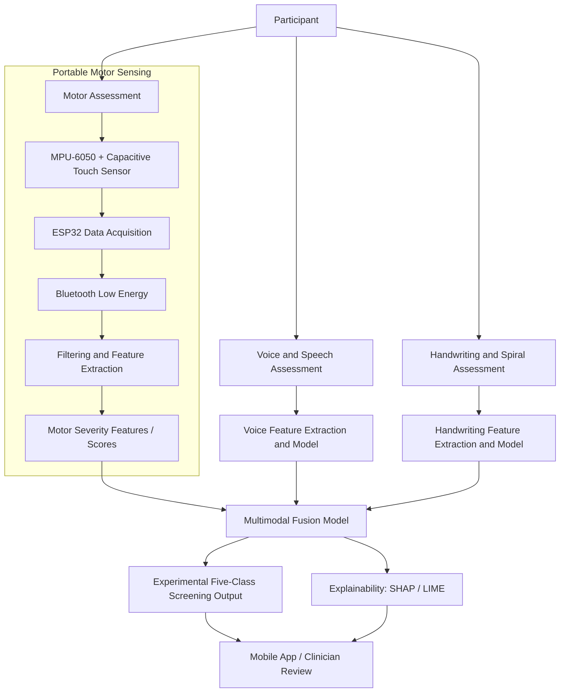

[README.md](https://github.com/user-attachments/files/33612440/README.md)
# Explainable Multimodal AI Framework for Parkinsonian Disorder Screening

**A research prototype combining portable motor sensing, voice assessment, handwriting analysis, and explainable AI to support early screening of Parkinsonian disorders.**

> **Project status:** Research and development. This system is **not clinically validated** and must not be used to diagnose patients or guide treatment decisions.

## Overview

Parkinsonian disorders can share symptoms such as tremor, slowed movement, altered gait, speech changes, and handwriting difficulties. Evaluating only one symptom or modality may miss important information.

This project investigates a **multimodal screening framework** that collects evidence from three assessment components and combines it in a fourth component:

1. **Motor Assessment** — a portable, wrist-worn sensing device captures movement and finger-tapping measurements.
2. **Voice and Speech Assessment** — speech recordings are analyzed for potentially relevant vocal features.
3. **Handwriting and Spiral Assessment** — writing and spiral-tracing patterns are analyzed for potential motor abnormalities.
4. **Prediction Fusion and Explainability** — component outputs are combined to estimate screening probabilities and explain influential features.

A mobile application is intended to guide assessment sessions, display results, and support clinician review.

### Target conditions

The research focuses on screening patterns associated with five conditions:

| Abbreviation | Condition |
| --- | --- |
| PD | Parkinson's disease |
| ET | Essential tremor |
| CA | Cerebellar ataxia |
| AP | Atypical parkinsonism |
| DLB | Dementia with Lewy bodies |

**Important:** These conditions have overlapping clinical features, and some are not themselves categorized as Parkinsonian disorders in the same way. The five-class task is an *experimental research objective*, not a clinically established differential-diagnosis tool.

## Research Objectives

- Design a low-cost, portable system for repeatable motor assessments.
- Extract relevant biomarkers from movement, voice, and handwriting data.
- Develop task-specific machine-learning models and combine their outputs.
- Investigate interpretable, potentially calibrated severity indicators and multi-class screening predictions.
- Provide understandable explanations to support clinician interpretation.
- Evaluate performance against appropriately labeled datasets and, when approved and feasible, specialist-confirmed clinical data.

## System Architecture



## Component 1: Motor Assessment

The motor component uses a portable wearable to capture motion and tapping data during standardized tasks.

### Proposed hardware

| Component | Purpose |
| --- | --- |
| ESP32 microcontroller | Sensor acquisition, device control, and BLE communication |
| MPU-6050 accelerometer and gyroscope | Three-axis linear acceleration and angular velocity measurements |
| Capacitive touch sensor | Finger-tap event detection |
| Rechargeable Li-Po battery | Portable power supply |
| Wrist-worn enclosure / strap | Consistent sensor placement during assessments |

**Proposed IMU sampling rate:** 100 Hz. The firmware design uses timed sampling and event-based tap detection.

### Proposed assessment protocol

| Assessment | Primary Sensor | Duration | Example Feature |
| --- | --- | --- | --- |
| Tremor | Accelerometer | 10 seconds | RMS dynamic acceleration |
| Rigidity-related movement | Gyroscope | 10 seconds | Mean peak angular velocity |
| Bradykinesia / finger tapping | Capacitive touch sensor | 10 seconds | Tap cadence (taps/min) |
| Gait | Accelerometer | 180 seconds | Estimated step cadence (steps/min) |

> A gyroscope alone does **not** measure clinical rigidity directly. The rigidity-related task can provide a movement proxy for research, but it cannot replace a clinician's examination. Wrist-based gait estimates also require technical and clinical validation.

### Motor processing pipeline

1. Acquire IMU and tap signals.
2. Apply appropriate filtering, gravity compensation, and task segmentation.
3. Extract features for each motor task.
4. Estimate task-level indicators using research-defined scoring rules or trained models.
5. Produce a combined motor representation for the fusion component.

**Proposed motor output:** tremor score (`TS`), rigidity-related score (`RS`), bradykinesia score (`BS`), gait score (`GS`), and combined motor score (`MS`). The intended range is **0–4** per indicator.

A proposed weighted aggregation is:

$$
MS = w_T TS + w_R RS + w_B BS + w_G GS
$$

where the weights are nonnegative and sum to one. Thresholds, weights, and any correspondence to clinical rating scales **must be established and validated**; these experimental scores must not be presented as validated MDS-UPDRS ratings.

## Component 2: Voice and Speech Assessment

This component investigates whether recorded speech provides useful complementary signals for screening. The proposed workflow includes:

- Guided voice recording through the application.
- Audio quality checks, noise reduction, and segmentation.
- Extraction of relevant acoustic and temporal features.
- Model inference to generate voice-related features or screening outputs for fusion.

The exact recording protocol, features, model architecture, and clinical interpretation will be documented as the component is developed.

## Component 3: Handwriting and Spiral Assessment

This component investigates fine-motor changes using handwriting and spiral-drawing tasks. The proposed workflow includes:

- Collection of a standardized writing or spiral sample.
- Image or trace preprocessing.
- Extraction of shape, smoothness, consistency, and other relevant features.
- Model inference to produce handwriting-related outputs for fusion.

The acquisition method and selected features will be finalized and documented during development.

## Component 4: Multimodal Fusion and Explainability

The fusion component is intended to integrate outputs from the motor, voice, and handwriting models, then produce an **experimental probability distribution** across the five target conditions.

Potential explanation methods include:

- **SHAP** — estimates how input features contribute to model outputs.
- **LIME** — provides local approximations of an individual prediction.

A credible five-class model requires **appropriately labeled and compatible training/validation data covering all five conditions**. Combining three scores or probabilities does not, by itself, create a validated five-disorder classifier. Probability calibration, missing-modality behavior, and explanations must be evaluated separately.

## Proposed Technology Stack

| Layer | Proposed Technologies |
| --- | --- |
| Wearable hardware | ESP32, MPU-6050, capacitive touch sensor |
| Embedded firmware | C/C++ using Arduino framework or ESP-IDF |
| Wireless communication | Bluetooth Low Energy (BLE) |
| Signal processing | Python, NumPy, SciPy |
| Machine learning | Python, scikit-learn; additional frameworks if needed |
| Explainable AI | SHAP, LIME |
| Application | Mobile application with clinician-facing assessment workflow; implementation framework TBD |
| Development | Git, GitHub |

Technology choices may change during experiments and integration.

## Research Datasets

Public datasets are being considered for exploratory analysis, pretraining, and reference measurements. Candidates include:

- **PADS** — Parkinsonian-related sensor and/or assessment research data.
- **Michael J. Fox Foundation Levodopa Response Study** — a potential source of Parkinson's-related movement measurements, subject to access and suitability.
- **PhysioNet gait datasets related to Parkinson's disease** — possible gait-pattern references.

Dataset names, licenses, task definitions, subject labels, sensor placements, and access requirements must be verified before use. These sources may **not** jointly provide sufficient evidence to train or evaluate all five target conditions. Dataset compatibility and leakage prevention are central parts of the research methodology.

## Repository Structure

The following layout is **illustrative**. Update it to reflect the directories that actually exist in this repository.

```text
parkinsonian-disorder-screening-ai/
├── firmware/                 # ESP32 sensor acquisition and BLE code
├── motor-assessment/         # Motor signal processing and experiments
├── voice-assessment/         # Audio processing and experiments
├── handwriting-assessment/   # Writing / spiral processing and experiments
├── fusion-explainability/    # Multimodal fusion, SHAP, and LIME
├── mobile-app/               # Assessment and clinician-review interface
├── shared/                   # Common schemas and integration utilities
├── docs/                     # Architecture, protocols, and research notes
├── tests/                    # Automated and integration tests
└── README.md
```

## Getting Started

> The repository's executable setup commands depend on which components have been committed. The steps below are a **development checklist**, not a claim that every directory or dependency file already exists.

1. Clone the repository:

   ```bash
   git clone https://github.com/<YOUR-USERNAME>/<YOUR-REPOSITORY>.git
   cd <YOUR-REPOSITORY>
   ```

2. For Python-based components, create a virtual environment:

   ```bash
   python -m venv .venv
   ```

   Activate it on **Windows**:

   ```powershell
   .venv\Scripts\activate
   ```

   Or on **macOS/Linux**:

   ```bash
   source .venv/bin/activate
   ```

3. Install dependencies **only where a component's `requirements.txt` exists**:

   ```bash
   pip install -r path/to/component/requirements.txt
   ```

4. Build and flash the ESP32 firmware using the toolchain specified in `firmware/` when that code is available.
5. Follow component-level instructions for data preparation, model training, application startup, and integration as those instructions are added.

**No pretrained clinical model or ready-to-run diagnostic service is supplied by this README.**

## Proposed Evaluation

Evaluation should include:

- **Sensor reliability:** sampling consistency, packet loss, repeatability, and battery/runtime behavior.
- **Motor assessment:** feature reproducibility and comparison with clinician-rated findings, where appropriate.
- **Model performance:** class-wise precision, recall, F1-score, confusion matrix, and balanced accuracy.
- **Probability quality:** calibration measurements, such as Brier score or expected calibration error, when valid probabilities are produced.
- **Robustness:** testing with missing modalities, recording noise, and differences between subjects or devices.
- **Clinical validity:** external evaluation on independent, specialist-confirmed cases before any clinical use claim.

Use **subject-level splits** to prevent recordings from the same participant appearing in both training and test sets.

## Data Privacy and Research Ethics

- Obtain required ethics approval and informed consent before collecting participant data.
- Do not commit identifiable patient recordings, clinical records, credentials, or private datasets to GitHub.
- Store sensitive data securely with appropriate access controls.
- Follow dataset-specific licenses, data-use agreements, and institutional research requirements.
- Clearly communicate that generated scores and predictions are experimental research outputs.

## Current Scope and Limitations

- This is a **research prototype**, not a medical device cleared or approved for clinical use.
- Public datasets may not adequately represent all five target conditions or real-world clinical populations.
- Sensor-derived indicators are not automatically equivalent to clinician-observed symptoms.
- Model explanations do not establish medical causation or guarantee reliable predictions.
- Clinical validation, calibration, and prospective testing remain necessary.

## Project Information

- **Project:** Explainable Multimodal AI Framework for Early Screening of Parkinsonian Disorders
- **Academic context:** Final-year research project
- **Project ID:** J26-IT-401
- **Institution:** Sri Lanka Institute of Information Technology (SLIIT)
- **Research areas:** Wearable sensing, signal processing, multimodal machine learning, explainable AI, mobile health

## Contributing

This project is under active academic development. Team members should work on feature branches, document any changes to assessment protocols or data schemas, and submit pull requests for review before merging.

## License

**License not yet specified.** Do not assume that the source code or third-party datasets may be redistributed until the project team chooses a license and confirms all relevant permissions.

## Medical Disclaimer

**For research and educational use only.** This framework is not intended to provide medical advice, establish a diagnosis, replace a neurologist's evaluation, or determine treatment. Anyone with concerning symptoms should seek advice from a qualified healthcare professional.
